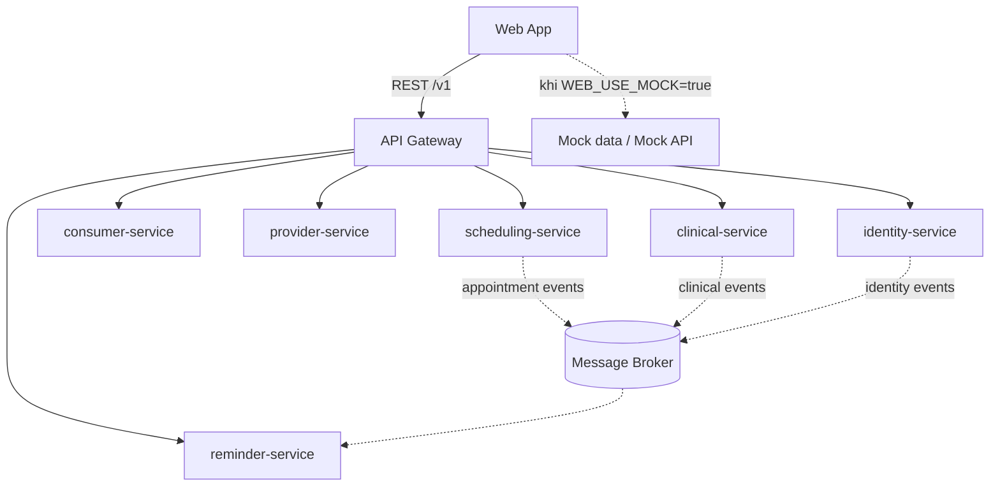

# MediBook - Nền tảng y tế theo kiến trúc SOA

MediBook kết nối người bệnh với nhà cung cấp dịch vụ y tế: tìm bác sĩ, đặt lịch khám,
quản lý hồ sơ bệnh án và nhận nhắc hẹn. Repo được tổ chức theo hướng **contract-first**
cho API và **mock-first** cho frontend.

> Trạng thái: 🚧 Khung dự án. Chưa có mã nguồn service; tài liệu và cấu trúc thư mục
> được chốt trước khi triển khai.

## 1. Mục tiêu

- Tách miền nghiệp vụ thành các service độc lập, mỗi service sở hữu dữ liệu riêng.
- Frontend có thể phát triển song song với backend nhờ mock và API contract.
- Mọi thay đổi API đều đi qua contract và ma trận hành vi (`matrix-api.md`).
- Không commit secret, dữ liệu bệnh nhân thật hoặc file build.

## 2. Kiến trúc tổng quan



- **Đồng bộ:** client → API Gateway → service qua REST `/v1`.
- **Bất đồng bộ:** các service publish/consume event qua message broker.
- **Xác thực:** Bearer JWT do `identity-service` phát hành, Gateway kiểm tra chữ ký.
- **Lỗi:** thống nhất theo RFC 9457 (`application/problem+json`).

## 3. Cấu trúc thư mục

```text
SOA.MediBook/
├── mock/                       # Mock data + mock API cho frontend
│   └── .gitkeep
├── web/                        # Thiết kế & triển khai giao diện frontend
│   └── .gitkeep
├── api-contract/
│   ├── api-contract.yaml       # Nguồn sự thật của API (OpenAPI 3.1)
│   └── matrix-api.md           # Ma trận hành vi/response của từng operation
├── service/
│   ├── api-gateway/
│   │   └── readme.md
│   ├── identity-service/
│   │   └── readme.md
│   ├── consumer-service/
│   │   └── readme.md
│   ├── provider-service/
│   │   └── readme.md
│   ├── scheduling-service/
│   │   └── readme.md
│   ├── clinical-service/
│   │   └── readme.md
│   └── reminder-service/
│       └── readme.md
├── .env.example                # Mẫu biến môi trường local
├── .gitignore
├── agent.md                    # Hướng dẫn cho AI coding agent
└── readme.md
```

## 4. Thành phần

| Thành phần | Trách nhiệm chính | API prefix (qua Gateway) | Tài liệu |
| --- | --- | --- | --- |
| `api-gateway` | Cửa ngõ duy nhất, routing, xác thực JWT, rate limit, CORS, tracing | `/v1/**`, `/health` | [readme](service/api-gateway/readme.md) |
| `identity-service` | Tài khoản, đăng nhập, token, vai trò, quyền | `/v1/identity/*` | [readme](service/identity-service/readme.md) |
| `consumer-service` | Hồ sơ người bệnh, người phụ thuộc, liên hệ | `/v1/consumers/*` | [readme](service/consumer-service/readme.md) |
| `provider-service` | Hồ sơ bác sĩ, cơ sở, chuyên khoa, xác minh | `/v1/providers/*` | [readme](service/provider-service/readme.md) |
| `scheduling-service` | Lịch trống, đặt/huỷ/đổi lịch hẹn | `/v1/availability/*`, `/v1/appointments/*` | [readme](service/scheduling-service/readme.md) |
| `clinical-service` | Buổi khám, bệnh án, ghi chú, đơn thuốc | `/v1/clinical/*` | [readme](service/clinical-service/readme.md) |
| `reminder-service` | Nhắc hẹn, thông báo đa kênh | `/v1/reminders/*` | [readme](service/reminder-service/readme.md) |
| `mock` | Dữ liệu giả lập và mock API cho frontend | - | `mock/` |
| `web` | Giao diện người dùng | - | `web/` |

## 5. Quy trình làm việc

1. **Thiết kế API:** cập nhật `api-contract/api-contract.yaml` và thêm dòng tương ứng
   vào `api-contract/matrix-api.md` trong cùng một PR.
2. **Thiết kế giao diện:** dựng UI từ mock trong `mock/`; mock phải khớp schema contract.
3. **Triển khai service:** đọc readme của service để nắm ranh giới trách nhiệm, dữ liệu
   sở hữu và event.
4. **Kiểm thử:** bổ sung test cho happy path, empty, validation, auth, conflict và lỗi
   server theo ma trận.

## 6. Quy ước chung

- **Ngôn ngữ:** tài liệu bằng tiếng Việt; tên biến, endpoint, field JSON bằng tiếng Anh.
- **API:** REST, version trong path (`/v1`), JSON `camelCase`.
- **Thời gian:** ISO 8601 UTC, ví dụ `2026-01-31T08:00:00Z`.
- **ID:** UUID v4.
- **Danh sách:** `page`, `pageSize`; response `{ items, page, pageSize, total }`.
- **Lỗi:** Problem Details + `code` ổn định + `traceId`.
- **Idempotency:** POST tạo giao dịch nhận `Idempotency-Key`.
- **Tracing:** `X-Correlation-Id` xuyên suốt client → gateway → service → event.
- **Secrets:** chỉ đặt trong `.env` hoặc secret manager, không commit.

## 7. Bắt đầu

```powershell
# 1. Tạo file môi trường local
Copy-Item .env.example .env

# 2. Đọc contract và ma trận API
#    api-contract/api-contract.yaml
#    api-contract/matrix-api.md
```

Mã nguồn frontend/service sẽ được scaffold sau khi chốt tech stack. Khi đó bổ sung
lệnh cài đặt/chạy/test tương ứng vào readme của từng phần.

## 8. Tài liệu

- [API contract](api-contract/api-contract.yaml)
- [Ma trận API](api-contract/matrix-api.md)
- [Hướng dẫn cho AI agent](agent.md)
- [Phạm vi demo](demo-scope.md) – Phân loại F001–F112 là MUST / SHOULD / OUT
